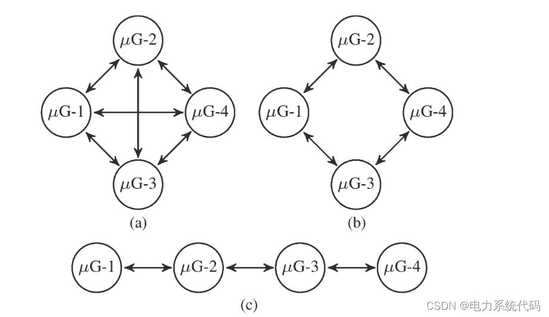
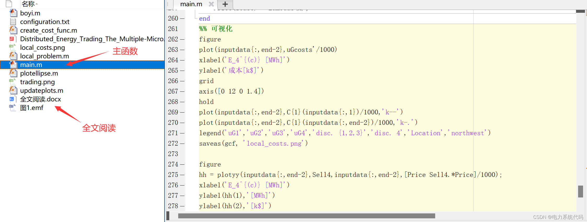
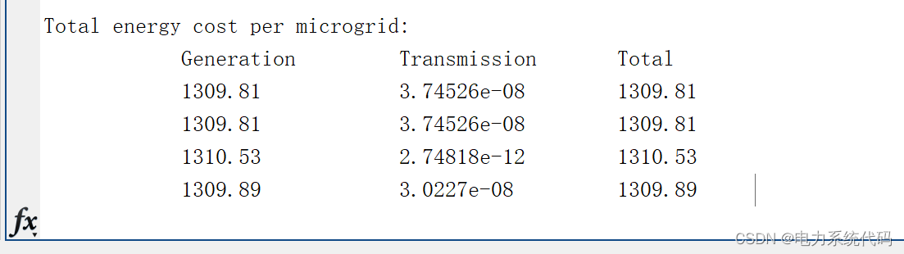
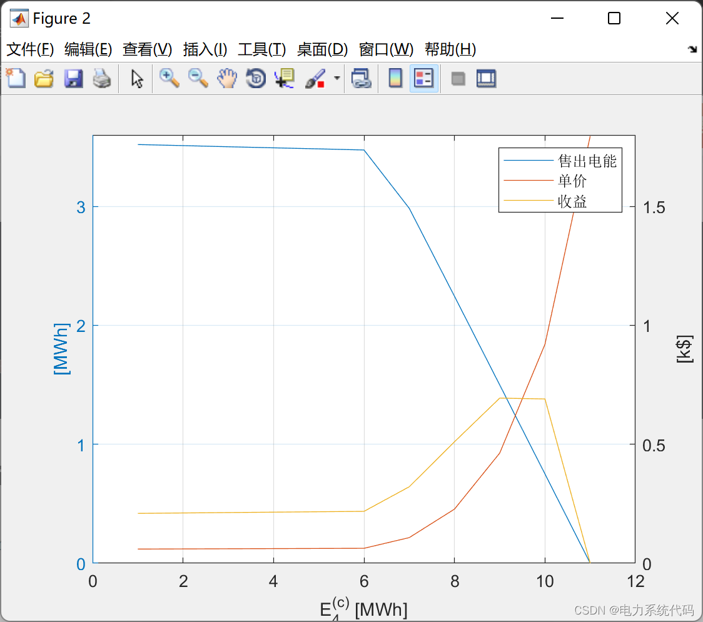
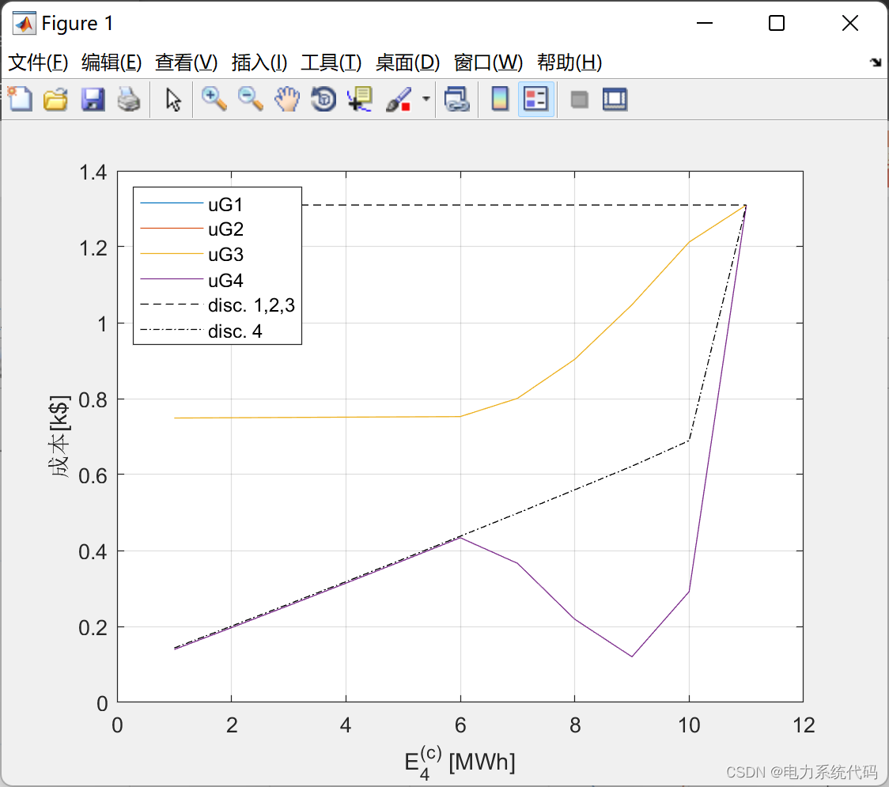

# Multi-Microgrid and Distributed Energy Trading (MATLAB Code Implementation)

​  
Contents
I. Overview
II. Mathematical Model
3. MATLAB Code Implementation
IV. Results Visualization
Editor
1. Overview of human, Driven by the energy demands of industry and electric vehicles. Global energy demand is expected to grow steadily in the coming years; More precisely, It is expected that the growth will reach 40% by 2030. This demand is due to the increasingly reliance on energy lifestyles of humans. The emergence of electric vehicles as the primary mode of transportation, along with machines promoting further automation of processes. In today's power grid, Energy is produced in centralized and large-scale energy plants (microgrid energy generation). Then, Transfer energy to the final client. It is usually achieved through very long distances and complex energy transmission grids. Such a complex structure. Flexibility decreased. Difficult to adapt to the growth of demand. This has increased the probability of grid instability and power outages. The impact is tremendous. The recent power outages in Europe and North America have proven this point, resulting in losses of several million euros.
To enhance the capabilities of smart grids, a typical approach involves considering scenarios where several microgrids exchange energy even though they are isolated from the main grid. In other words, there is an energy flow within a group of consecutive microgrids, but no energy flow between them and the main grid. Against this backdrop, the optimal power flow problem has recently garnered significant attention. For instance, Ochoa and Harrison jointly considered the optimal power flow problem with coordinated voltage control. Alternatively, works in related literature have focused on unbalanced distribution networks, proposing a method to solve three-phase power flow problems based on Newton's method.Due to the potential scalability and privacy issues associated with these centralized solutions, generally, optimal power flow problems are non-convex; therefore, exact solutions may be too complex to compute. As a result, suboptimal methods are often employed. Some literature adopts what is known as the multiplier alternating direction method (see distributed approaches for solving power flow problems),
Editor
3. Matlab Code Implementation
This article only showcases a portion of the code, all codes can be found here:
%% Visualization\nfigure\nplot(inputdata{:,end-2},uGcosts'/1000)\nxlabel('E_4^{(c)} [MWh]')\nylabel('Cost[k$]')\ngrid\naxis([0 12 0 1.4])\nhold\nplot(inputdata{:,end-2},C{1}(inputdata{:,1})/1000,'k--')\nplot(inputdata{:,end-2},C{1}(inputdata{:,end-2})/1000,'k-.')\nlegend('uG1','uG2','uG3','uG4','disc. {1,2,3}','disc. 4','Location','northwest')\nsaveas(gcf, 'local_costs.png')\n\nfigure\nhh = plotyy(inputdata{:,end-2},Sell4,inputdata{:,end-2},[Price Sell4.*Price]/1000);\nxlabel('E_4^{(c)} [MWh]')\nylabel(hh(1),'[MWh]')\nylabel(hh(2),'[k$]')\ngrid\naxis(hh(1),[0 12 0 3.6])\nset(hh(1),'YTick',0:3)\naxis(hh(2),[0 12 0 1.8])\nset(hh(2),'YTick',0:.5:1.5)\nlegend('Selling electrical energy', 'Unit price', 'Profit')\nsaveas(gcf, 'trading.png')\n  
IV. Results Visualization Editing  
Editing  
Editing  
Editing

## Images

<!-- PAYMENT_BLOCK -->

## Get this dataset

- Payment link (Stripe): [Buy now](https://buy.stripe.com/3cs8yP7sY87d0vu9AB)
- Payment QR code: 

<!-- /PAYMENT_BLOCK -->
